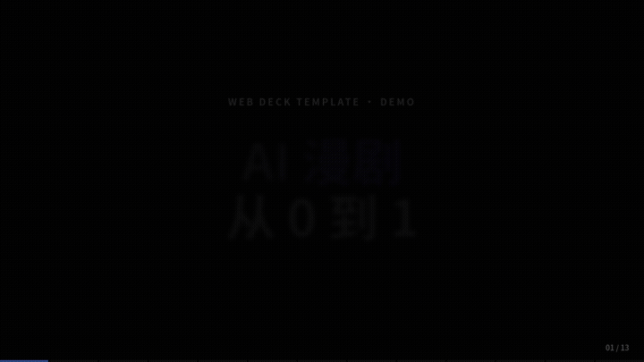
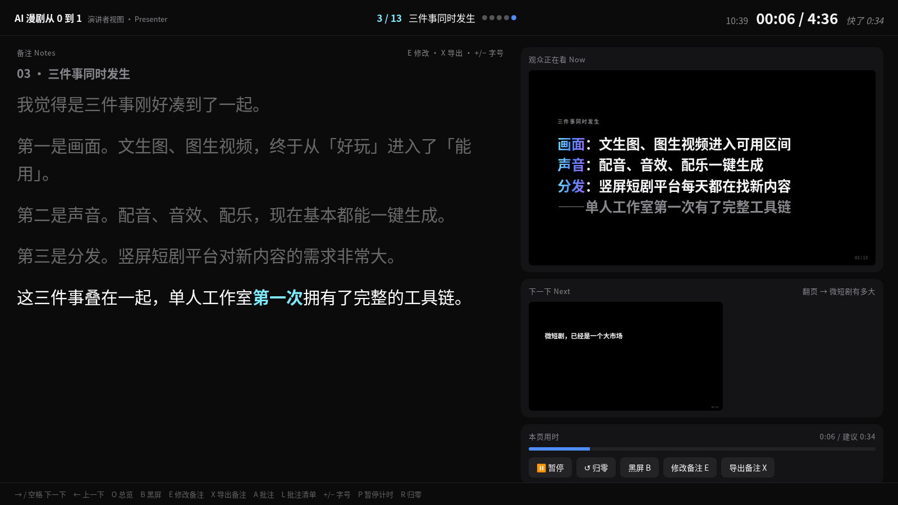
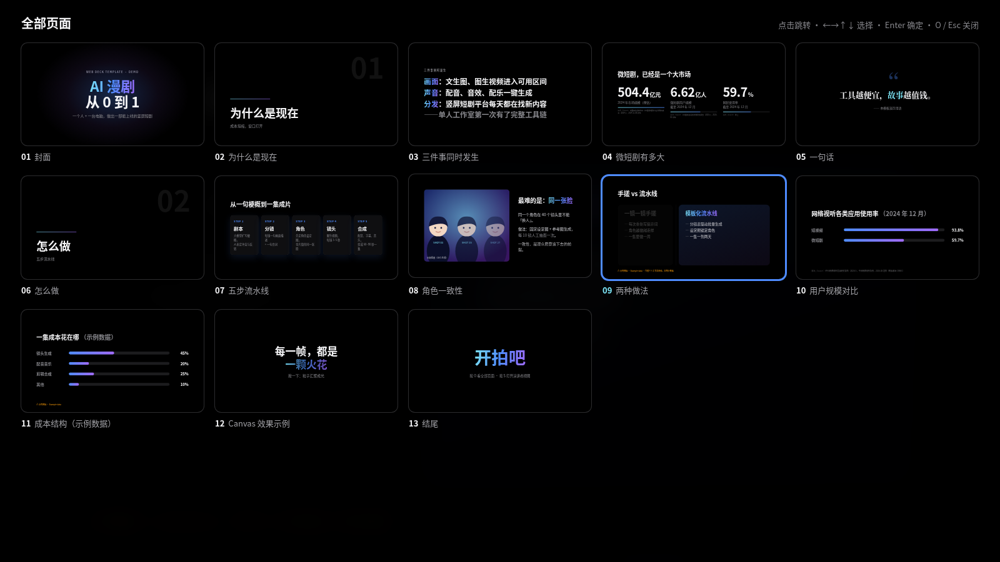
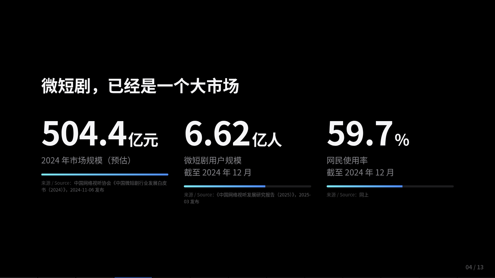
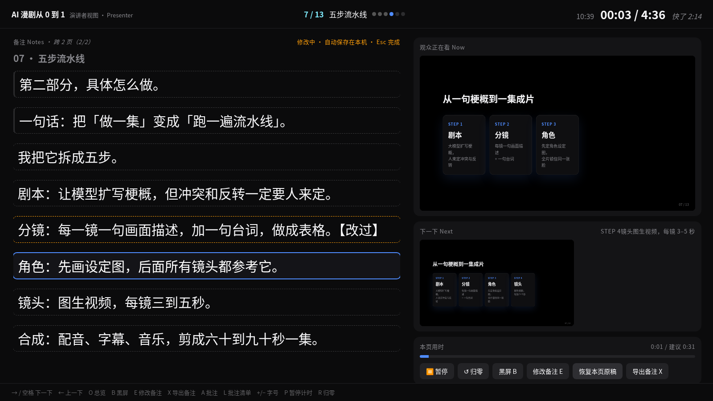

# Web Deck Template · 网页幻灯片模板



| 观众屏 Audience | 演讲者视图 Presenter | 总览 Overview |
|---|---|---|
|  |  |  |

| 带出处的数据页 Sourced stats | 现场改备注 Edit notes |
|---|---|
|  |  |

纯静态 HTML / CSS / JS 的演讲幻灯片模板：**零框架、零构建、零依赖**。双击 `index.html` 就能讲，原样拖到 Cloudflare Pages 就能上线。

[English below ↓](#english)

---

## 中文

### 30 秒上手

```bash
git clone https://github.com/Gusulanwater/web-deck-template.git my-talk
cd my-talk
open index.html          # macOS；Windows 直接双击，Linux 用 xdg-open
```

1. 按 **→ / 空格** 讲下去，按 **S** 打开演讲者视图（允许弹窗）。
2. 打开 `assets/slides.js`，改 `SLIDES` 数组里的字。
3. 打开 `assets/notes.js`，写每页的逐字稿。刷新即可。

> 想用局域网 / 手机看：`python3 -m http.server 8000`，然后访问 `http://<IP>:8000`。

### 特性

- 固定 **1920×1080** 舞台，按窗口等比缩放，任何屏幕版式都一致。
- **数据驱动**：每页是 `slides.js` 里的一个对象，11 种版式。
- **分步动画**：元素标 `data-s="n"`，引擎给当前页加 `active` 和 `st0…stN`，元素加 `.on`；动画全靠 CSS transition / keyframes。
- **演讲者视图**：当前画面、下一下预览、逐字稿（随步骤高亮）、总计时 + 每页建议用时 + 快慢提示。
- **双向同步**：postMessage + BroadcastChannel 兜底，`file://` 下也能用；任一窗口翻页 / 黑屏，另一边跟着走。
- **改稿 / 导出 / 跨页备注**：演讲者视图里 E 现场改、X 导出 notes.js + .md；一段稿子可以跨几页。
- **真实数据出处**：stats / bars / compare 支持 `source`，示例数据有醒目标注。
- **批注**：排练时按 A 给「第几页第几下」记修改意见，L 查看 / 复制 / 下载。存在本机 localStorage。
- **深链**：`#5` = 第 5 页，`#5.2` = 第 5 页第 2 下（也兼容 `?s=4&t=2`，从 0 数）。
- **系统中文字体**：PingFang SC / 苹方、Songti SC / 宋体，无需加载 Web 字体。
- **Canvas 2D 自定义效果**示例（`canvas` 版式里的粒子）。

### 快捷键

| 按键 | 观众屏 | 演讲者视图 |
|---|---|---|
| → ↓ 空格 PageDown Enter / 点击 | 下一下（走完自动翻页） | 下一下 |
| ← ↑ PageUp Backspace | 上一下 | 上一下 |
| Home / End | 第一页 / 最后一页 | 第一页 |
| O | 总览（←→↑↓ 选，Enter 跳，Esc 关） | 总览 |
| F | 全屏 | — |
| B 或 . | 黑屏 | 黑屏（观众屏同步） |
| S | 打开演讲者视图 | — |
| A | 写批注 | 写批注 |
| L | 批注清单 | 批注清单 |
| E | — | 修改当前页备注（Esc 完成） |
| X | — | 导出备注（notes.js + notes.md） |
| + / − | — | 备注字号 |
| P / R | — | 暂停 / 归零计时 |

### 写幻灯片（`assets/slides.js`）

```js
{ id: 'why', type: 'lines', title: '三件事', kick: '小标题',
  lines: ['[[强调]]：第 1 下出现', '第 2 下出现', { t: '{{进页就有}}', s: 0 }] }
```

- `id`：唯一，用来对应备注；`title`：总览和演讲者视图里显示的名字。
- 行内标记：`[[强调渐变]]`、`{{灰色}}`、`((钛银))`、`\n` 换行。
- 列表项默认依次占一下；写成 `{ t: '…', s: n }` 指定第 n 下出现（0 = 进页就有）。

| type | 字段 | 说明 |
|---|---|---|
| `title` | `kick` `h` `sub` | 封面，背景光晕 |
| `section` | `no` `h` `sub` | 章节页 |
| `lines` | `kick` `lines[]` | 一行一行出现 |
| `quote` | `q` 或 `lightup` · `cite` | 引语；`lightup` 逐字点亮 |
| `stats` | `h` `items[{n,dec,unit,lab,w,source}]` `source` `example` | 数字滚动 + 进度条 + 出处 |
| `bars` | `h` `rows[{k,v,source}]` `source` `example` | 横向对比条 + 出处 |
| `compare` | `h` `a{h,li[]}` `b{h,li[]}` `focusAt` `source` | 左右对比，第 focusAt 下聚焦右栏 |
| `image` | `h` `src` 或 `art` · `cap` `paras[]` | 图文；图片 Ken Burns 缓推 |
| `steps` | `h` `cards[{k,h,p}]` | 流程卡片 |
| `canvas` | `fx` `h` `sub` | Canvas 2D 自定义效果（示例：粒子） |
| `end` | `h` `sub` | 结尾 |

**加一种新版式**：在 `slides.js` 的 `R` 里加一个渲染函数（返回 HTML 字符串，用 `S(n)` 标步骤），在 `deck.css` 里写 `.t-你的类型` 和 `.t-你的类型.st2 …` 的样式。需要 JS 的效果写进 `window.onStep(i, step, sectionEl)`——引擎每一步都会调它（总览缩略图也会，传入的是克隆）。

### 写备注（`assets/notes.js`）

```js
window.NOTES = {
  why: [
    '进页就讲的一段。',
    [1, '第 1 下时讲的一段，**重音**，（舞台提示会变色）'],
  ],
};
```

演讲者视图会按当前步骤高亮对应段落，并按约 220 字/分钟估算每页建议用时。

**一段稿子跨几页**：

```js
howto: { span: ['s2', 'pipeline'], paras: [
  '在 s2 进页时讲',
  [1, 's2 第 1 下'],
  ['pipeline', 0, '从这里起属于 pipeline 页'],   // [页id, 第几下, 文字]
  [2, 'pipeline 第 2 下'],                       // 不写页id = 沿用上一段的页
] }
```

跨的每一页都显示整段稿子：前面讲过的变淡、当前这一句高亮、后面的半透明，标题旁显示「跨 2 页（1/2）」。

**现场改稿 / 导出**：在演讲者视图按 **E**（或点「修改备注」）直接改当前页备注，自动保存到本机 localStorage，覆盖 notes.js 原文；改过的段落标「已修改」。Esc 或点别处即保存，「恢复本页原稿」撤销本页所有修改。按 **X**（或「导出备注」）下载合并了修改的 `notes.js`（直接替换 `assets/notes.js`）和一份 `notes.md`。

### 正式演讲：用真实数据

正式场合的每一个数字都必须有出处：

- `stats` 每个条目、`bars` 每行或整页、`compare` 每栏或整页，都支持 `source` 字段，会以小字「来源 / Source：…」显示在页面上。
- 写法：`source: '机构《报告名》，发布日期'`；也可以写 `{ text: '…', example: true }`。
- 还没有真实数据时，给整页加 `example: true`（或 source 里写 `example: true`），页面会显示橙色「⚠ 示例数据 · Example data」，避免被误当成真实数据。
- 引用前请到原始出处核对数字、口径（预估 / 实际、统计截止时间）。

```js
{ id: 'market', type: 'stats', h: '市场规模', items: [
  { n: 504.4, dec: 1, unit: '亿元', lab: '2024 年市场规模（预估）',
    source: '中国网络视听协会《中国微短剧行业发展白皮书（2024）》，2024-11-06' } ] }
```

演示 deck 里「微短剧有多大」与「用户规模对比」两页使用有出处的公开数据（2024 年微短剧市场规模预估 504.4 亿元；截至 2024-12 用户 6.62 亿、使用率 59.7%；短视频使用率 93.8%，来源：中国网络视听协会相关白皮书 / 研究报告）。「两种做法」对比页为作者工作流经验（非统计数字），已标明出处。演示中不含未经验证的数值占位页。

### 部署到 Cloudflare Pages

- **拖拽**：Cloudflare 控制台 → Workers & Pages → Create → Pages → Upload assets，把整个文件夹拖进去。
- **命令行**：`npx wrangler pages deploy . --project-name my-talk`
- **Git**：连接仓库，Framework preset 选 *None*，Build command 留空，Output directory 填 `/`。

GitHub Pages、Netlify、Vercel 或任意静态服务器同理。

### 文件结构

```
index.html          入口（只有舞台和 4 个 <script>）
assets/deck.css     设计变量、舞台、所有版式与动画、演讲者视图样式
assets/slides.js    页面数据 SLIDES + 版式渲染器 + onStep 钩子 + Canvas 示例
assets/notes.js     window.NOTES 逐字稿
assets/deck.js      引擎：缩放、步骤、翻页、总览、黑屏、深链、演讲者视图、同步
assets/annotate.js  批注（A / L）
docs/               截图与 GIF
```

---

## English

A presentation template in plain static HTML/CSS/JS — **no framework, no build step, no dependencies**. Double-click `index.html` to present; drop the folder onto Cloudflare Pages to publish.

### 30-second quickstart

```bash
git clone https://github.com/Gusulanwater/web-deck-template.git my-talk
cd my-talk
open index.html          # or double-click / xdg-open
```

1. Press **→ / Space** to advance, **S** to open the speaker view (allow pop-ups).
2. Edit the `SLIDES` array in `assets/slides.js`.
3. Write your speaker notes in `assets/notes.js`. Reload.

### Features

- Fixed **1920×1080** stage, scaled to fit the window.
- **Data-driven** slides (11 layout types) with inline markup `[[accent]]`, `{{muted}}`, `((silver))`, `\n`.
- **Step reveals**: mark elements `data-s="n"`; the engine adds `active` + `st0…stN` to the slide and `.on` to revealed elements; all motion is CSS.
- **Speaker view** (`S` or `?presenter=1`): current slide, next-step preview (`?preview=1` iframe), notes highlighted per step, timer with per-slide pacing.
- **Two-way sync** over postMessage with a BroadcastChannel fallback — works from `file://`.
- **Annotations** (`A` add, `L` list/copy/download) stored in localStorage.
- **Deep links**: `#5` (slide 5) or `#5.2` (slide 5, step 2); also `?s=4&t=2` (0-based).
- System Chinese fonts (PingFang SC, Songti SC); no web fonts.
- A **Canvas 2D** custom-effect slide (`canvas` type, particles) as an example.

### Hotkeys

| Key | Audience | Presenter |
|---|---|---|
| → ↓ Space PageDown Enter / click | next step (auto-advances slide) | next |
| ← ↑ PageUp Backspace | previous | previous |
| Home / End | first / last slide | first |
| O | overview grid | overview |
| F | fullscreen | — |
| B or . | blackout | blackout (synced) |
| S | open speaker view | — |
| A / L | add annotation / list | same |
| E | — | edit current notes in place (Esc to finish) |
| X | — | export notes (notes.js + notes.md) |
| + / − | — | notes font size |
| P / R | — | pause / reset timer |

### Writing slides & notes

See the Chinese section above for the field table; each slide is `{ id, type, title, ...fields }`. List items reveal one per step by default; use `{ t, s }` to pin a step (0 = visible on entry). Notes: `window.NOTES = { slideId: ['para', [stepN, 'para shown at step N']] }`; `**bold**` and `（stage directions）` are styled.

**One note across several slides**: `key: { span: ['s2', 'pipeline'], paras: ['…', [1, '…'], ['pipeline', 0, 'from here on belongs to pipeline'], [2, '…']] }`. Every spanned slide shows the whole note with past / current / upcoming highlighting.

**Edit & export**: in the speaker view press **E** to edit the current notes in place (auto-saved to localStorage, overriding notes.js; edited paragraphs are marked; Esc or blur saves; "恢复本页原稿" reverts the slide). Press **X** to download a merged, drop-in `notes.js` plus `notes.md`.

### Real data for formal talks

Every number must cite its source. `stats` items, `bars` rows/slides and `compare` columns/slides accept `source: 'Org, Report, date'` (or `{ text, example: true }`), rendered as a small citation on the slide. Without real data, set `example: true` to show an orange "⚠ Example data" label. Verify figures and their definitions (estimate vs. actual, cut-off date) against the primary source. The demo's market-stats and usage-bars slides use sourced public figures from China Netcasting Services Association reports. The compare slide is clearly experiential (workflow experience, non-numeric) and labeled as such. The demo has no unverified numeric placeholder slides.

To add a layout: add a renderer to `R` in `slides.js`, style `.t-yourtype` / `.t-yourtype.stN` in `deck.css`, and put any JS effect in `window.onStep(i, step, el)`.

### Deploy to Cloudflare Pages

- Dashboard → Workers & Pages → Create → Pages → **Upload assets**, drop the folder; or
- `npx wrangler pages deploy . --project-name my-talk`; or
- Connect the Git repo: preset *None*, no build command, output directory `/`.

## License & credits

[MIT](LICENSE). Architecture notes: [CREDITS.md](CREDITS.md).
